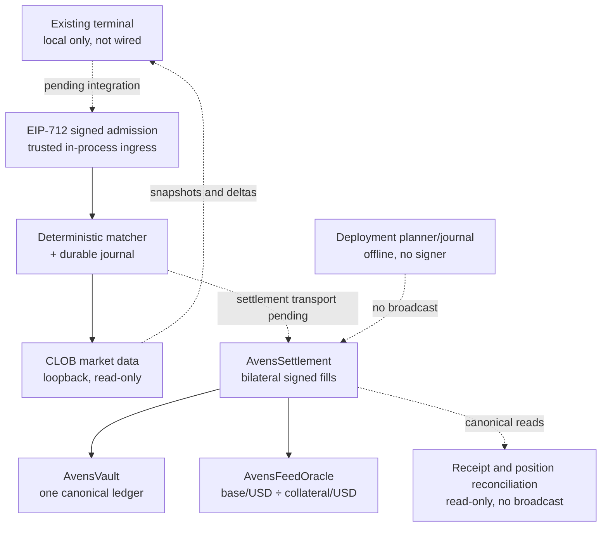

# Avensdex

**A development-stage perpetual exchange implementation for Avalanche C-Chain Fuji.**

Avensdex is an Avalanche port of the NEARFlow perpetual trading design. The repository contains a deterministic offchain matcher, an EIP-712 authorized bilateral settlement path, a canonical collateral ledger, bounded funding/close/liquidation logic, a capped Fuji activation path and read-only qualification tooling.

It is **not deployed**, has **no public fills or liquidity**, and is **not production software**. Mainnet is disabled. No security audit is claimed.

## Status at a glance

| Area | State |
| --- | --- |
| Network target | Avalanche C-Chain Fuji (`43113`); local tests use `31337` |
| Mainnet | Disabled and rejected by contracts/config |
| Public deployment / activation | None |
| Public transactions / fills / receipts | None |
| Contract execution support | Manual vanilla limit orders only |
| Trading service | Read-only; `/ready` and mutations return `503` |
| Config | `executionEnabled:false`, `mainnetEnabled:false` |
| UI | Existing NEARFlow UI preserved locally only; not in the published tree |
| Audit | No independent audit; point-in-time `npm audit` only |

Development status is tracked in [Roadmap](docs/ROADMAP.md), [Phase 3 status](docs/PHASE3_STATUS.md) and [live-trading blockers](docs/LIVE_TRADING_BLOCKERS.md).

## Navigation

- [What works today](#what-works-today)
- [Architecture](#architecture)
- [Network, units and trust model](#network-units-and-trust-model)
- [Developer quickstart](#developer-quickstart)
- [Verification evidence](#verification-evidence)
- [Repository layout](#repository-layout)
- [Documentation](#documentation)
- [Roadmap and demo path](#roadmap-and-demo-path)
- [Security and scope](#security-and-scope)
- [Provenance, licensing and contribution](#provenance-licensing-and-contribution)

## What works today

### Implemented in the repository (local or contract capability)

- **Canonical exact-delta ledger** — free collateral, order escrow, bilateral pair margins, opening fees and insurance reconcile to token custody in one vault ledger.
- **Bilateral EIP-712 settlement** — two signed sides, cumulative fills, nonce binding, exact-hash cancellation, explicit nonce invalidation and atomic rollback.
- **Bounded lifecycle** — funding-index application with payer clipping, partial/full owner closes and capped liquidation.
- **Capped Fuji activation capability** — fresh vaults start paused; only the bootstrap owner can bind settlement and activate; the Fuji liability cap is at most 10 USDC (`10_000_000` base units).
- **Two-feed oracle** — independently validates two Chainlink feeds and returns base/USD divided by collateral/USD (candidate: AVAX/USD ÷ USDC/USD) with per-feed freshness.
- **Offchain market data** — deterministic one-market price-time matching, durable journal, EIP-712 signed admission, sequenced loopback HTTP/WebSocket service and a client resync reducer.
- **Offline deployment planning** — a draft planner/journal binds Fuji scope, reviewed artifacts, nonces, gas budget and plan hash; it has no operator signer and does not broadcast.
- **Qualification tooling** — two-provider Fuji RPC checks, a fresh loopback Anvil lifecycle and a pinned historical-fork check.

### Not integrated or not publicly verified

- Public deployment, activation, collateral acquisition/deposit/withdrawal, fills or hedges.
- Contract execution for market, reduce-only, post-only, IOC or strategy orders. The offchain matcher supports some of these semantics, but the supported contract settlement rejects them.
- Adaptive funding controller, existing-terminal wallet/browser integration, live Guardian/Autopilot and genuine spot/hedge routes.
- Public feed/asset/venue qualification, a finality/reorg operating policy and independent security review.
- An integrated public operator signing and policy-confirmed reader pipeline. A read-only two-provider deployment reader and fixed-endpoint inspection CLI exist, but they are not wired to an operator signer, the deployment journal or any submission path; the trusted-publisher adapter remains local-only.
- Hosted production service, public authentication, rate limiting or abuse controls.

The active product is Fuji-only with no PAPER mode or simulated-execution fallback. Local unit, fuzz, benchmark and fork fixtures are tests, not public trades or liquidity.

## Architecture



One canonical ledger owns free collateral, escrow, pair margins, fees and insurance. Strategy inventory is deferred to the same ledger before strategy execution can be enabled. Offchain matching is provisional; only canonical settlement creates a position.

## Network, units and trust model

- **Network:** Avalanche C-Chain Fuji, chain ID `43113`. Local development uses `31337`. Mainnet is rejected by contracts and configuration.
- **Units:** collateral uses six-decimal base units; order size is `size6`; prices are `price18`; funding indices are `index18`. Native AVAX gas is distinct from wrapped inventory and collateral.
- **Positions:** isolated bilateral pairs. Each pair holds both sides' margin; profit is capped by that pair's collateral and cannot reach unrelated users' funds.
- **Authority:** a bootstrap owner controls the single settlement binding, activation and entry pause. The frozen settlement is the only external module with ledger authority; owners deposit and withdraw through the vault. Withdrawals are fixed-recipient owner payouts.
- **Trust assumptions:** the matcher is centralized and has ordering, censorship and liveness risk. Local publishers and oracle fixtures are trusted components, not qualified public infrastructure. A Fuji deployment would also depend on USDC issuer/proxy controls (pausable, blacklistable, upgradeable) and Chainlink aggregator governance.
- **Failure behavior:** stale prices, invalid signatures, replay, overfills, mismatched ledgers, reorgs and unknown transaction outcomes fail closed. Exact-delta checks revert rather than inventing payouts.

## Developer quickstart

### Pinned toolchain

| Tool | Version | Source |
| --- | --- | --- |
| Node.js | `22.22.3` | `.node-version`, `package.json` |
| npm | `10.9.8` | `package.json` |
| Python | `3.12.3` | CI workflow |
| Foundry (`forge`, `anvil`) | `1.8.3` | CI workflow / `contracts/evm/.foundry-version` |
| Solidity | `0.8.30` | `contracts/evm/foundry.toml` |
| EVM target | `paris` | `contracts/evm/foundry.toml` |
| Rust | `1.96.0` | `rust-toolchain.toml` |

### Install and run the local suite

These commands run local tests only. They do not start a live trading service, sign with an operator wallet or send public transactions.

```sh
git clone https://github.com/wolf1276/avensdex.git
cd avensdex
npm ci --ignore-scripts
npm run typecheck
npm test
npm run test:funding:rust
forge fmt --root contracts/evm --check
npm audit --omit=dev
```

`npm test` runs the TypeScript funding/protocol/CLOB suites, the Python read-only network tests, the Foundry suites and a fresh loopback-only Anvil settlement lifecycle with generated fixture keys.

### Offline deployment plan

The offline plan CLI reads a planner input and reviewed artifacts from local files and prints the existing validated paused plan, including its plan hash and disabled/approval-required status. It has no signer, RPC, broadcast or journal path:

```sh
npm run deployment:plan -- /absolute/path/planner-input.json /absolute/path/reviewed-artifacts.json
```

The artifacts file must already match the planner's `{ abi, bytecode }` schema for `AvensVault`, `AvensFeedOracle` and `AvensSettlement`; the CLI does not read Foundry output or compile contracts. See [paused deployment planning](docs/PAUSED_DEPLOYMENT_RECOVERY.md#offline-plan-cli) for input limits and artifact preparation.

### Optional read-only network checks

Requires Python 3.12 and no wallet or secrets:

```sh
python3 -m unittest discover -s scripts -t . -v
python3 scripts/qualify_fuji.py
python3 -m scripts.compare_fuji_rpcs
# Set FUJI_DEPLOYER_ADDRESS to a public address, never a private key.
python3 -m scripts.preflight_fuji --deployer "${FUJI_DEPLOYER_ADDRESS:?Set your public Fuji deployer address}"
```

The preflight exits `2` when deployment remains blocked even if the account is funded, and `1` on failure. These probes use fixed public RPC endpoints and read-only methods.

The optional historical fork check uses read-only RPC methods plus locally impersonated issuer fixtures; it does not acquire public tokens or submit public transactions:

```sh
node --experimental-strip-types scripts/qualify-fuji-fork.mjs
```

The read-only deployment reader CLI prints two-provider observations from the fixed Fuji endpoints. It has no signer or write method:

```sh
npm run deployment:read -- head
npm run deployment:read -- block <decimal-block-number>
npm run deployment:read -- transaction <tx-hash>
npm run deployment:read -- receipt <tx-hash>
npm run deployment:read -- code <address> <decimal-block-number>
```

The read-only deployment reader CLI prints two-provider observations only. A separate journal reconciliation CLI opens an existing journal and may write local reconciliation evidence; its RPC reads remain read-only:

```sh
npm run deployment:reconcile -- /absolute/external/path/journal /absolute/path/planner-input.json /absolute/path/reviewed-artifacts.json /absolute/path/runtime-config.json
```

### Read-only market-data service

Use a journal directory outside the repository. The service binds to `127.0.0.1`, reports `503` for readiness and all mutations, and has no signer.

```sh
CLOB_JOURNAL_DIR=/absolute/external/path/avensdex-clob npm run clob:serve -- --create
CLOB_JOURNAL_DIR=/absolute/external/path/avensdex-clob npm run clob:serve
```

See [CLOB service operations](docs/CLOB_SERVICE.md) for restart, journal and recovery rules. Starting it is not a public deployment.

## Verification evidence

Local verification checkpoint: committed revision `643aa16`. Clean tracked-source archive checks passed:

- `npm ci --ignore-scripts`, `npm run typecheck` and `npm test` pass.
- `109` TypeScript tests: `4` funding, `27` protocol, `78` CLOB.
- `118` Foundry tests, including configured `1,000`-case fuzz properties.
- `30` Python tests and `4` locked Rust reference tests.
- `24` fresh local Anvil receipts in the local settlement lifecycle.

Additional checks against the same contract source covered `27` local historical Fuji-fork receipts at block `61048431`. Root `npm audit --omit=dev` reported `0` vulnerabilities at that checkpoint; this is a point-in-time dependency check, not a security audit.

The current tree adds `17` protocol tests for the read-only two-provider deployment reader and its fixed-endpoint inspection CLI, plus `4` offline deployment-plan CLI tests; `npm run typecheck` and `npm run test:protocol` (`48` tests) pass locally. These are unit fixtures with mocked RPC providers or local JSON files, not public Fuji reads or a deployment.

These are local or pinned historical-fork results. They are not public Fuji transactions, public finality, liquidity, asset qualification or a hosted service. Counts are revision- and environment-scoped and will change as the repository changes. No public addresses, receipt links, deployments or fills are claimed.

## Repository layout

```text
contracts/evm/       Solidity vault, settlement, oracle, funding/risk libraries and tests
packages/clob/       Matcher, journal, signed admission, reconciliation and settlement reader
packages/funding/    TypeScript/Rust funding references, vectors and notices
packages/protocol/   Units/risk math, manifest parser and offline deployment planner
services/clob/       Loopback read-only HTTP/WebSocket market-data service
scripts/             Python Fuji qualification and Anvil/fork checks
config/              Fuji manifest and NEARFlow source provenance
docs/                Architecture, status, gates, evidence and runbooks
legacy/nearflow/     Ignored local baseline; not published
```

## Documentation

- [Architecture](docs/ARCHITECTURE.md)
- [Roadmap](docs/ROADMAP.md)
- [Foundation checks](docs/FOUNDATION_CHECKS.md)
- [Phase 3 local settlement status](docs/PHASE3_STATUS.md)
- [CLOB engine](docs/CLOB_ENGINE.md), [signed admission](docs/CLOB_ADMISSION.md), [service](docs/CLOB_SERVICE.md)
- [Collateral vault](docs/COLLATERAL_VAULT.md), [settlement reconciliation](docs/SETTLEMENT_RECONCILIATION.md), [oracle boundary](docs/SETTLEMENT_ORACLE.md)
- [Capped Fuji activation](docs/FUJI_ACTIVATION.md), [two-feed adapter](docs/FUJI_FEED_ADAPTER.md), [paused deployment recovery](docs/PAUSED_DEPLOYMENT_RECOVERY.md)
- [Fuji qualification](docs/FUJI_QUALIFICATION.md), [live-trading blockers](docs/LIVE_TRADING_BLOCKERS.md), [baseline provenance](docs/NEARFLOW_BASELINE.md)
- [Dependencies and notices](docs/DEPENDENCIES.md)

## Roadmap and demo path

The active task list is [`todo.md`](todo.md). The [roadmap](docs/ROADMAP.md) keeps public gates separate from implemented code.

Current local demo path:

1. Run `npm ci --ignore-scripts` and `npm test` to execute the matcher, contract, funding, Python and Anvil checks.
2. Optionally run the read-only service and inspect `/health`, `/snapshot` and the loopback WebSocket stream.
3. Optionally run the historical-fork qualification to reproduce local contract lifecycle receipts.

No live URL, public demo, hosted deployment or trading session is available. Remaining work includes public asset/oracle/venue/finality qualification, adaptive funding and mark/epoch integration, existing-terminal wallet/browser wiring, policy-confirmed reader data, live Guardian/Autopilot, genuine spot/hedge execution, independent review and a separately authorized capped deployment. No completion date is promised.

## Security and scope

- Mainnet is disabled. Public deployment, activation and signing require a separate bounded plan and explicit authorization.
- Do not bypass readiness/mutation `503` responses, set `executionEnabled:true`, insert placeholder addresses or add a server signer to simulate live trading.
- Preserve owner-only payouts, the single settlement binding, oracle freshness, replay protection, exact token deltas and canonical receipt reconciliation.
- Reconcile unknown transactions before retrying. A submitted or acknowledged match is not a filled position or hedge.
- Unsupported contract order types remain rejected. Do not treat offchain matcher support as onchain settlement support.
- No security audit, production-readiness, market-liquidity, uptime, decentralization or profitability claim is made.
- Do not commit secrets, wallet material, generated reports, journals or funded-state resets.

## Provenance, licensing and contribution

This repository is derived from a user-provided NEARFlow working source. Provenance and file hashes are recorded in [`config/nearflow-source.json`](config/nearflow-source.json) and [the baseline report](docs/NEARFLOW_BASELINE.md). The full baseline is kept in the ignored `legacy/nearflow/` directory and is not published.

The existing landing and trading UI is preserved locally for reference, but its landing source/artwork redistribution rights are unresolved. It is not part of the published tracked tree and has not been reauthored. Do not publish those files until the rights question is resolved.

No project-wide source license was supplied, and there is no root `LICENSE` file. Nothing in this repository grants an MIT, Apache or other open-source license for the project source. Third-party components retain their own licenses and notices:

- `packages/funding/NOTICE` and `packages/protocol/NOTICE` record NEARFlow provenance and do not grant redistribution rights.
- The ignored local baseline retains `legacy/nearflow/client/licenses/terminal/` and `legacy/nearflow/client/licenses/walletconnect/` notices; they must accompany any reused UI code or assets.
- `viem` `2.57.19` and `ws` `8.23.0` are MIT-licensed dependencies; see [dependency notices](docs/DEPENDENCIES.md).

Contribution practice: keep changes scoped, include tests for behavior changes, preserve provenance and notices, avoid secrets and generated artifacts, and keep local instructions and the ignored baseline out of commits.
